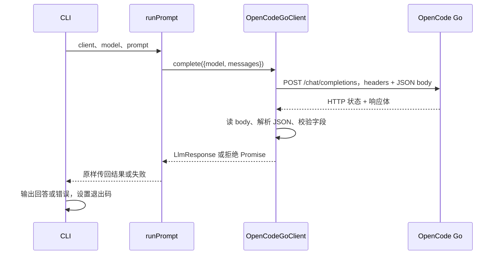

# OpenCode Go HTTP 接口契约

状态：`accepted`

适用阶段：阶段 01，单次、非流式文本问答。

本文约定 yucli 怎样调用 OpenCode Go、怎样把其响应转换为内部结果。内容依据当前实现、已有本地 HTTP 测试和阶段 01 真实联调记录，不代表 OpenCode Go 的完整官方 API 规范。本文中的请求、响应数据均为说明用示例，不包含真实凭证或真实回答。

## 调用双方与职责

| 参与方 | 做什么 | 输入与输出 |
| --- | --- | --- |
| `bootstrap/cli.ts` | 检查参数、加载配置、创建客户端、输出结果 | `--prompt` → `runPrompt(...)` → stdout 或 stderr |
| `core/runPrompt.ts` | 把用户原文包装为一条 user 消息 | prompt 与模型名 → `LlmRequest` |
| `OpenCodeGoClient.complete()` | 将内部请求发往 OpenCode Go，处理 HTTP 和响应校验 | `LlmRequest` → `Promise<LlmResponse>`，失败则拒绝 Promise |
| OpenCode Go 服务 | 接收模型名与消息，返回 Chat Completions 响应 | HTTP JSON 请求 → HTTP 状态与响应体 |

`LlmRequest`、`LlmResponse` 是项目内部的数据结构；HTTP 请求和响应是双方在网络上传输的数据格式。它们通过 adapter 转换，core 不需要访问服务端的 `choices` 数组。



## 从终端输入到模型消息

例如执行：

```bash
pnpm dev --prompt "解释一下 Promise"
```

CLI 先确认 prompt 非空白，再加载配置。`runPrompt` 将它包装成内部请求：

```json
{
  "model": "deepseek-v4-flash",
  "messages": [
    { "role": "user", "content": "解释一下 Promise" }
  ]
}
```

`model` 来自 `OPENCODE_GO_MODEL` 或默认值；`content` 保留用户输入原文，包括其中的空格和换行。阶段 01 不主动添加 system message，也不附加过去问答或项目文件。

内部接口允许 `system`、`user`、`assistant` 纯文本消息；adapter 按调用方给出的消息顺序发送，不修改请求对象。当前 adapter 信任内部 TypeScript 契约，不额外对传入的 `LlmRequest` 做完整运行时校验；CLI 的正常路径只构造一条 user 消息。

## HTTP 请求契约

### 地址与方法

```text
POST {去掉末尾斜线的 baseUrl}/chat/completions
```

默认完整地址为：

```text
https://opencode.ai/zen/go/v1/chat/completions
```

`baseUrl` 来自 `OPENCODE_GO_BASE_URL`。配置加载器只允许无内嵌凭证、查询参数和片段的 HTTP(S) URL。客户端不请求 `/models`，不自动跟随重定向，也不重试请求。

### 请求头：认证和路由

```http
Authorization: Bearer <api-key>
Content-Type: application/json
x-opencode-session: <本次请求的随机 UUID>
```

| 字段 | 值从哪里来 | 用途 |
| --- | --- | --- |
| `Authorization` | `OPENCODE_GO_API_KEY`，由配置模块读取后传给客户端 | 向服务端认证；密钥不放入消息、JSON body 或 URL |
| `Content-Type` | adapter 固定设置 | 告诉服务端 body 是 JSON |
| `x-opencode-session` | 每次 `complete()` 内调用 `randomUUID()` | 提供服务路由标识；不代表本地已保存会话或服务会自动补齐历史 |

阶段 01 首次真实请求因缺少路由头返回 HTTP 400 `MissingSessionID`，补充后成功，依据见 [ADR-002](../decisions/ADR-002-opencode-session-routing.md)。本阶段每次调用独立问答，路由 ID 不持久化；未来多轮对话需要重新确定其生命周期。

上表列的是客户端显式设置的应用请求头，底层 fetch 还可能自动生成传输所需的请求头。

### 请求体：模型要看到的信息

adapter 从内部请求取出 `model` 和 `messages`，额外加入 `stream: false`：

```json
{
  "model": "deepseek-v4-flash",
  "messages": [
    { "role": "user", "content": "解释一下 Promise" }
  ],
  "stream": false
}
```

对应实现中的关键代码：

```ts
body: JSON.stringify({
  model: request.model,
  messages: request.messages,
  stream: false,
}),
```

`JSON.stringify` 将 JavaScript 对象变成 JSON 文本，fetch 把文本放入 HTTP body。TypeScript 接口只帮助本地编译检查，不会自动把对象发送出去；实际传输由 `fetch(...)` 完成。

| 请求体字段 | 规则 |
| --- | --- |
| `model` | 要调用的模型标识，默认 `deepseek-v4-flash` |
| `messages` | 有序消息数组；当前消息内容为字符串 |
| `stream` | 固定为 `false`，本阶段读取完整 JSON 回答 |

本阶段不发送 temperature、工具声明、response format 等字段。认证密钥、超时值和 AbortSignal 均不进入请求体；AbortSignal 用于本地取消网络操作。

## 成功响应与内部转换

### 服务端返回的结构

HTTP 2xx 响应示例：

```json
{
  "choices": [
    {
      "message": {
        "role": "assistant",
        "content": "Promise 表示一个异步操作的最终结果。"
      },
      "finish_reason": "stop"
    }
  ],
  "usage": {
    "prompt_tokens": 12,
    "completion_tokens": 18
  }
}
```

其他字段可以存在，但阶段 01 只提取下表中的字段：

| 服务端字段 | 检查与处理 | 内部字段 |
| --- | --- | --- |
| `choices[0].message.role` | 必须为 `assistant` | `message.role` |
| `choices[0].message.content` | 必须是非空白字符串；返回时保留原文 | `message.content` |
| `usage.prompt_tokens` | 存在时必须为非负安全整数 | `usage.inputTokens` |
| `usage.completion_tokens` | 存在时必须为非负安全整数 | `usage.outputTokens` |

只取第一条 choice，不合并其他候选答案。`usage` 可以缺失；存在时必须是非 null、非数组对象。两个 token 字段可以分别缺失，缺失不等于用量为 0；例如 `usage: {}` 会转换成空用量对象。

当前实现不根据 `finish_reason` 判断文本是否完整，也不输出 `reasoning_content`，不接收工具调用作为成功回答。即使服务返回工具相关字段，content 缺失或空白也会触发响应错误。

### 响应按什么顺序处理

1. `await fetch(...)` 得到 Response，先检查 `response.ok` 是否为 true，即 HTTP 状态在 200—299。
2. 对成功状态调用 `await response.text()` 读完响应体。拿到响应头不等于回答已经读完；这一段也受超时和取消控制。
3. 调用 `controller.signal.throwIfAborted()` 再次检查取消状态。
4. `JSON.parse(body)` 把 JSON 文本转成 JavaScript 数据。语法不合法则产生 `ResponseError`。
5. `parseResponse(parsed)` 校验上述业务字段并构造内部结果。给数据写类型断言不会代替这一步校验。
6. 返回 `LlmResponse`，经 runPrompt 交给 CLI；CLI 的 `await` 得到最终对象后输出 `result.message.content` 并追加换行。

当前实现不检查成功响应的 Content-Type，而是直接尝试解析 JSON；成功响应体没有应用层长度上限。512 字节限制只适用于失败响应的诊断摘要。

上述示例转换成：

```json
{
  "message": {
    "role": "assistant",
    "content": "Promise 表示一个异步操作的最终结果。"
  },
  "usage": {
    "inputTokens": 12,
    "outputTokens": 18
  }
}
```

CLI 最后只向 stdout 输出回答文本，退出码为 0。用量统计保留在结果对象中，当前 CLI 不展示；原始响应、reasoning 和认证信息不进入正常输出。

## 失败怎样传回 CLI

`complete` 是 async 方法。它内部的 throw 会使返回的 Promise 拒绝；runPrompt 原样返回该 Promise，最终由 CLI 的 `await` / `catch` 接住，不会把错误当作模型回答。

| 情况 | adapter 或配置层的处理 | CLI 结果 |
| --- | --- | --- |
| 密钥缺失、端点或超时非法 | 请求前抛 `ConfigError` | stderr，退出码 3 |
| 连接失败、发送失败、响应体传输中断 | `RequestError`，code 为 `network` | stderr，退出码 4 |
| 超时首先触发 | `RequestError`，code 为 `timeout` | stderr，退出码 4 |
| 调用方取消首先触发 | `AbortError` | stderr，退出码 4 |
| HTTP 非 2xx | 读有限摘要，抛 `RequestError`，code 为 `http` | stderr，退出码 4 |
| HTTP 2xx，但不是有效 JSON | `ResponseError` | stderr，退出码 4 |
| JSON 有效，但回答或用量字段不符合契约 | `ResponseError` | stderr，退出码 4 |

例如服务端返回 HTTP 400 和下面的响应体：

```json
{
  "type": "error",
  "error": {
    "type": "MissingSessionID",
    "message": "Request is missing x-opencode-session"
  }
}
```

客户端根据 HTTP 状态进入失败分支，不执行正常回答解析，也不依赖 `error.type` 这样的提供方字段来分类。它读取最多 512 字节用于诊断，遮盖已知密钥、截断处密钥前缀和 Authorization/Bearer 内容，去除控制字符，再限制摘要为最多 512 字节。

`RequestError` 保留稳定的 code、说明和已获得的 status；正常读完失败摘要时也保留 responseSummary。若失败响应体本身读取超时或中断，则按 timeout/network 处理，已取得的 HTTP 状态仍可附带。重定向被 fetch 拒绝，当前按 network 分类，不保证提供重定向的状态码。

## 超时、取消和资源归属

超时来自 `YUCLI_REQUEST_TIMEOUT_MS`，默认 120000 毫秒，配置允许 1—2147483647 的整数。每次调用独立创建 AbortController、定时器和外部 signal 的监听器。

- 超时与外部取消都触发内部控制器，fetch 接收内部 signal；外部 AbortSignal 本身不会被发送给服务端。
- 内部只记录第一次取消原因，避免超时和调用方取消互相覆盖。
- 定时器覆盖请求和响应体读取；读取结束前不会因拿到响应头而撤销超时。
- complete 的 finally 清理定时器和外部监听器；错误摘要读取的 finally 取消剩余读取并释放 reader 锁。
- 取消代表本地停止等待/读取，不保证服务端已停止推理或撤销费用。当前 CLI 不提供额外取消交互，接口级取消能力供调用方和测试使用。

## 验证依据与兼容性

| 检查范围 | 对应位置 |
| --- | --- |
| 请求 URL、headers、路由 UUID、body 和响应映射 | [client.test.ts](../../tests/client.test.ts) |
| HTTP/网络错误、错误摘要、响应非法、超时和取消 | [client.test.ts](../../tests/client.test.ts) |
| 配置优先级、默认值与非法值 | [config.test.ts](../../tests/config.test.ts) |
| 源码/产物 CLI 的 stdout、stderr 和退出码 | [cli.test.ts](../../tests/cli.test.ts) |
| 真实服务路由要求和成功调用记录 | [阶段 01](../specs/phase-01-single-model.md)、[ADR-002](../decisions/ADR-002-opencode-session-routing.md) |

测试覆盖范围以各测试实际断言为准，不能将本文所有说明都理解为已有独立测试。本次补文档对照了当前实现及测试，没有再次调用服务。

后续加入流式响应、工具调用、多轮历史或不同模型协议时，必须同步修改本文、[LlmClient 契约](llm-client.md)、adapter 和相应测试；提供方路由 ID 的生命周期变化也需要更新 ADR。

源码入口：[runPrompt.ts](../../src/core/runPrompt.ts)、[OpenCodeGoClient.ts](../../src/adapters/opencode-go/OpenCodeGoClient.ts)、[cli.ts](../../src/bootstrap/cli.ts)。
